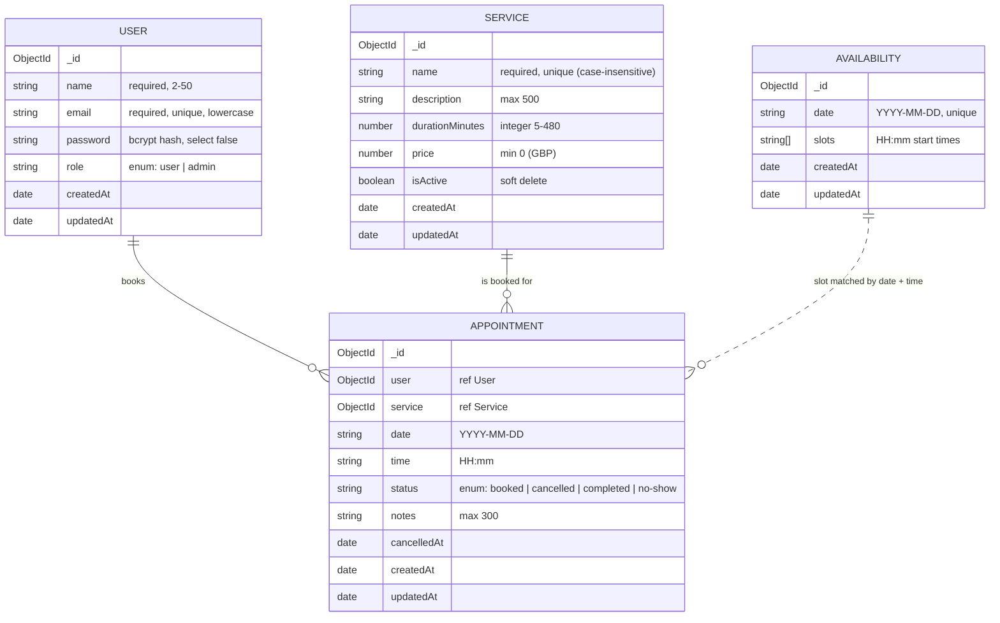

# Appointment Booking System (MERN)

Milestone 4 — **Option A: Appointment Booking System** for a private **medical & dental clinic** in the UK.
Patients browse services, see free time slots and book them — with **no double-booking**. Admins manage
services, opening hours and appointments.

Two roles: **User** (patient) and **Admin** (clinic staff).

## Live links

| | URL |
|---|---|
| Frontend (Vercel) | https://bookeasy-rho.vercel.app |
| API (Render) | https://bookeasy-api-qa0f.onrender.com |
| Health check | https://bookeasy-api-qa0f.onrender.com/api/health |
| GitHub | https://github.com/khushi898/appointment-booking |

> The API runs on Render's free plan, which sleeps after ~15 minutes without traffic. The first request
> after that takes up to a minute while it wakes up — open the health check URL first.

## Test credentials

| Role | Email | Password |
|---|---|---|
| Admin | `admin@bookeasy.test` | `Adminbookeasy@123` |
| User | `demo.patient@bookeasy.test` | `BookEasyDemo2026!` |

These are demo accounts for reviewers only.

---

## Features

**User (patient)**
- Register / log in / log out, with the API's error messages shown on the form
- Browse services (name, description, duration, price) with search, sort and pagination
- See free slots for the next 30 days and book one (date + time); a taken slot returns **409**
- "My Appointments": upcoming and past tabs, cancel an upcoming booking

**Admin**
- Dashboard stat cards computed with a **MongoDB aggregation** (counts by status, today, upcoming, revenue)
- Create / edit / delete (soft) / reactivate services
- Set available slots per day (with a "generate every 30 min from 09:00 to 17:00" helper); booked slots are locked
- View all appointments — paginated, filtered by status/date, searchable by customer or service
- Mark past appointments **completed** or **no-show**

**Stretch goals done:** server-side sorting (`?sort=`), admin stats via aggregation, token-expiry handling
(any 401 logs the user out).

## Tech stack

| Layer | Technology |
|---|---|
| Frontend | React 19 (Vite, JavaScript), React Router, Tailwind CSS v4 with hand-written components |
| Backend | Node.js, Express 5 |
| Database | MongoDB Atlas, Mongoose |
| Auth & security | bcrypt (`bcryptjs`), JWT, role middleware, CORS, `express-rate-limit`, Helmet |
| Validation | Zod (requests) + Mongoose schema validation |
| Tests | Jest, Supertest, mongodb-memory-server (123 tests) |
| Deployment | Render (API), Vercel (frontend) |

## Project structure

```
server/                 Express REST API
  src/
    config/             env + MongoDB connection
    models/             User, Service, Availability, Appointment
    validators/         Zod request schemas
    middleware/         auth (protect/adminOnly), validate, rateLimiter, errorHandler, notFound
    controllers/        request handlers
    routes/             URL → middleware → controller
    utils/              ApiError, token, pagination, dateTime, slots
    scripts/            seed:admin, seed:services
  tests/                Jest + Supertest tests
client/                 React frontend
  src/
    lib/api.js          fetch wrapper (base URL, JWT header, errors)
    context/            AuthProvider / useAuth
    components/         ui/ (Button, Input…), layout, route guards, admin components
    pages/              user pages + pages/admin/
postman/                Postman collection covering every endpoint
```

## Database schema



- **Appointment → User + Service** use `ref`, and the API returns joined data with `.populate()`.
- **Availability** is one document per day. Appointments match it by `date` + `time` (no ref needed).
- Dates and times are stored as `"YYYY-MM-DD"` / `"HH:mm"` strings in the clinic's timezone
  (`BUSINESS_TIMEZONE`), so a booking never shifts to another day because of UTC conversion.

### How double-booking is prevented

```js
appointmentSchema.index(
  { date: 1, time: 1 },
  { unique: true, partialFilterExpression: { status: 'booked' } }
);
```

A **partial unique index**: MongoDB allows only one `booked` appointment per date + time. If two patients
book the last slot at the same moment, both requests reach `Appointment.create()`, MongoDB accepts exactly
one and rejects the other with duplicate-key error `11000`, which the controller returns as **409 Conflict**.
Cancelled/completed/no-show appointments are outside the index, so cancelling frees the slot.
There is deliberately no "check, then insert" — that has a race window. A test fires 10 simultaneous
bookings and asserts exactly one 201 and nine 409s.

## API endpoints

Base URL: `/api`. Protected routes need the header `Authorization: Bearer <token>`.

**Access levels:** Public = no token · User = any logged-in user · Owner = the user who made the booking · Admin = role `admin`

| Method | Path | Access | Description |
|---|---|---|---|
| GET | `/api/health` | Public | API and database status |
| POST | `/api/auth/register` | Public (rate-limited) | Create a user account, returns JWT |
| POST | `/api/auth/login` | Public (rate-limited) | Log in, returns JWT |
| GET | `/api/auth/me` | User | Current user |
| GET | `/api/services?page=&limit=&search=&sort=` | Public | Active services, paginated |
| GET | `/api/services?includeInactive=true` | Admin | Also inactive (deleted) services |
| GET | `/api/services/:id` | Public | One service |
| POST | `/api/services` | Admin | Create service |
| PATCH | `/api/services/:id` | Admin | Update service (partial) |
| DELETE | `/api/services/:id` | Admin | Soft delete (`isActive: false`) |
| GET | `/api/availability?from=&to=` | Public | Open days in a range (default next 30 days) with booked/available slots |
| GET | `/api/availability/:date` | Public | Slots for one day with booked/available slots |
| PUT | `/api/availability/:date` | Admin | Create or replace a day's slots |
| DELETE | `/api/availability/:date` | Admin | Close a day (409 if it has bookings) |
| POST | `/api/appointments` | User | Book `{ serviceId, date, time, notes? }` (409 if slot taken) |
| GET | `/api/appointments/me?type=upcoming\|past&page=&limit=` | User | My appointments |
| PATCH | `/api/appointments/:id/cancel` | Owner | Cancel an upcoming booking |
| GET | `/api/appointments?page=&limit=&status=&date=&from=&to=&search=&sort=` | Admin | All appointments, filtered |
| GET | `/api/appointments/stats` | Admin | Dashboard stats (aggregation) |
| PATCH | `/api/appointments/:id/status` | Admin | Mark `completed` / `no-show` |

### Status codes

| Code | When |
|---|---|
| 200 / 201 | Success / created |
| 400 | Validation failed (response includes `details: [{ field, message }]`), invalid id, business rule (e.g. booking in the past) |
| 401 | No token, invalid or expired token, wrong email/password |
| 403 | Logged in but not allowed (user on an admin route, cancelling someone else's booking) |
| 404 | Resource or route not found |
| 409 | Conflict: slot already booked, duplicate email / service name, removing a booked slot |
| 429 | Too many auth attempts (rate limit) |
| 500 | Unexpected error — generic message only, never a stack trace |

Every error has the shape `{ "success": false, "message": "...", "details"?: [...] }`.

## Security

- Passwords hashed with **bcrypt** (cost 12) in a Mongoose pre-save hook; `select: false` keeps the hash out of queries
- **JWT** (`sub` = user id, `role`, expiry) verified by `protect`; the user and role are re-loaded from the DB on every request
- **`adminOnly`** returns 403 for normal users; registering with `role: "admin"` is ignored
- **CORS** allows only `CLIENT_ORIGIN` (never `*`)
- **Rate limiting** on `/api/auth` (20 requests / 15 min per IP); `trust proxy` so it sees real client IPs behind Render
- **Helmet** security headers, 10 kb JSON body limit, regex-escaped search input
- Secrets only in `.env` (git-ignored from the first commit); `.env.example` files show the variable names

---

## Run locally

Requirements: Node.js 20+, a MongoDB Atlas cluster (or local MongoDB).

```bash
# 1. API
cd server
cp .env.example .env        # fill in MONGODB_URI, JWT_SECRET, ADMIN_* …
npm install
npm run seed:admin          # creates the admin from ADMIN_EMAIL / ADMIN_PASSWORD
npm run seed:services       # adds 20 clinic services (safe to run again)
npm run dev                 # http://localhost:5000

# 2. Frontend (second terminal)
cd client
cp .env.example .env.local  # VITE_API_URL=http://localhost:5000
npm install
npm run dev                 # http://localhost:5173
```

### Environment variables

**server/.env**

| Variable | Example | Purpose |
|---|---|---|
| `NODE_ENV` | `development` / `production` | Environment |
| `PORT` | `5000` | Port (Render sets this automatically) |
| `MONGODB_URI` | `mongodb+srv://…/appointment-booking` | Atlas connection string |
| `CLIENT_ORIGIN` | `http://localhost:5173` | Allowed CORS origin(s), comma-separated |
| `BUSINESS_TIMEZONE` | `Europe/London` | Clinic timezone for "today" / "past" |
| `JWT_SECRET` | long random string | Signs JWTs |
| `JWT_EXPIRES_IN` | `1d` | Token lifetime |
| `AUTH_RATE_LIMIT_MAX` | `20` | Auth requests per IP per 15 min |
| `ADMIN_NAME` / `ADMIN_EMAIL` / `ADMIN_PASSWORD` | | Used only by `npm run seed:admin` |

**client/.env.local** — `VITE_` variables are built into the public JavaScript, so never put secrets here.

| Variable | Example | Purpose |
|---|---|---|
| `VITE_API_URL` | `http://localhost:5000` | API base URL (no trailing slash) |
| `VITE_CURRENCY` | `GBP` | Currency for prices |

### Scripts

| Where | Command | What it does |
|---|---|---|
| server | `npm run dev` | Start API with auto-restart |
| server | `npm start` | Start API (production) |
| server | `npm test` | Run the 123 Jest tests on an in-memory MongoDB |
| server | `npm run seed:admin` | Create/promote the admin account |
| server | `npm run seed:services` | Add the 20 clinic services |
| client | `npm run dev` | Start the frontend |
| client | `npm run build` | Production build into `dist/` |
| client | `npm run lint` | ESLint |

## Tests

`cd server && npm test` — 123 tests (Jest + Supertest) run against **mongodb-memory-server**, a throwaway
in-memory database, so they never touch Atlas. They cover auth (bcrypt hash stored, 401/403, expired and
forged tokens, rate limiting), validation, pagination/search/sort, availability rules, booking rules,
the double-booking race (10 simultaneous requests → exactly one booking), cancellation, admin filters and stats.

> `npm test` runs Jest with Node's `--experimental-vm-modules` flag: the MongoDB driver loads Node's `os`
> module with a dynamic `import()`, which fails inside Jest's sandbox without it.

## Postman

Import [`postman/AppointmentBooking.postman_collection.json`](postman/AppointmentBooking.postman_collection.json)
(Postman → Import). Then in **Collection → Variables** set:

- `baseUrl` — `http://localhost:5000` or your Render URL
- `adminEmail` / `adminPassword` — the seeded admin

Run the folders in order (or **Run collection**). 49 requests cover every endpoint, including the error cases
for the demo: 401 without a token, 403 for a user on an admin route, 409 for a double booking.
Login requests save `userToken` / `adminToken` automatically. The test day is `2099-12-31`, so the
collection never changes real availability; each run creates two test users and one (soft-deleted) test service.
Running it more than twice within 15 minutes hits the auth rate limit (429).

---

## Deployment

### 1. MongoDB Atlas — allow the API to connect
1. Atlas → **Network Access** → **Add IP Address** → **Allow access from anywhere** (`0.0.0.0/0`) → Confirm.
   Render's free plan has no fixed IP address, so a specific IP can't be allowed. The database is still
   protected by its username and a strong password.
2. Use the same connection string as in your local `.env` (the data you seeded is already there).

### 2. Backend on Render
1. https://render.com → **New** → **Web Service** → connect GitHub → choose this repository.
2. Settings:
   - **Root Directory:** `server`
   - **Runtime:** Node
   - **Build Command:** `npm install`
   - **Start Command:** `npm start`
   - **Instance Type:** Free
3. **Environment Variables** (do not set `PORT` — Render provides it):
   `NODE_ENV=production`, `MONGODB_URI`, `JWT_SECRET` (a new random value), `JWT_EXPIRES_IN=1d`,
   `BUSINESS_TIMEZONE=Europe/London`, `CLIENT_ORIGIN` (set in step 4 below; use `http://localhost:5173` for now).
4. **Advanced → Health Check Path:** `/api/health`
5. **Create Web Service**, wait for "Live", then open `https://<your-api>.onrender.com/api/health`
   (this project: https://bookeasy-api-qa0f.onrender.com/api/health).

### 3. Frontend on Vercel
1. https://vercel.com → **Add New → Project** → import this repository.
2. **Root Directory:** `client` (Framework preset **Vite** is detected; build `npm run build`, output `dist`).
3. **Environment Variables:** `VITE_API_URL=https://bookeasy-api-qa0f.onrender.com` (no trailing slash), `VITE_CURRENCY=GBP`.
4. **Deploy** and copy the URL (this project: `https://bookeasy-rho.vercel.app`).

`client/vercel.json` rewrites every path to `index.html`, so refreshing a page like `/appointments`
works (React Router handles the URL in the browser). `VITE_` variables are baked in at build time —
after changing one, redeploy.

### 4. Connect them (CORS)
Render → your service → **Environment** → set `CLIENT_ORIGIN=https://bookeasy-rho.vercel.app`
(exact URL, no trailing slash) → **Save** (Render redeploys). Open the Vercel site and log in.

## Known limitations

- Time slots are shared by all services (one clinic diary): a 60-minute service booked at 09:00 does not block 09:30.
- "Completed revenue" uses each service's current price; changing a price later changes past revenue.
- Render's free plan sleeps when idle (first request can take ~1 minute).
